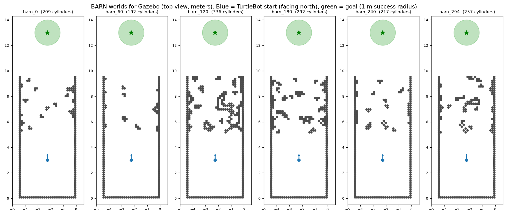

# barn_gazebo：BARN 地圖放進 Gazebo（ROS 2 Jazzy + Gazebo Harmonic）

BARN Challenge 官方的地圖是 Gazebo Classic（ROS 1）格式，Jazzy 的 Gazebo Harmonic 不能直接開。
這個套件把**跟 2D 實驗同一批的 50 張**（編號 0, 6, 12, …, 294）轉成 Harmonic 格式，
圓柱位置、半徑 0.075 m、高 1 m 都照原始檔，已逐張核對跟 2D 實驗的地圖格子完全一致。



## 一、安裝（只做一次）

在 Ubuntu（WSL）終端機：

```bash
# 1. 複製到你的 ROS 2 workspace（假設是 ~/ros2_ws，不是的話改成你的路徑）
cp -r "/mnt/c/Users/cheeh/car control project/barn_gazebo" ~/ros2_ws/src/

# 2. 編譯
cd ~/ros2_ws
colcon build --packages-select barn_gazebo
source install/setup.bash
```

需要的套件：`ros_gz_sim`、`ros_gz_bridge`（裝 Gazebo 時通常已經有）。
用官方 TurtleBot3 的話還要 `turtlebot3_gazebo`（`sudo apt install ros-jazzy-turtlebot3-gazebo`）。

## 二、開一張地圖

```bash
export TURTLEBOT3_MODEL=burger
ros2 launch barn_gazebo barn.launch.py world:=0
```

會一次開好：Gazebo（地圖）、TurtleBot3 Burger（放在起點、朝北）、ROS ↔ Gazebo 的橋、成績記錄（barn_eval）。

| 參數 | 預設 | 說明 |
|---|---|---|
| `world` | `0` | 地圖編號 0, 6, 12, …, 294。編號越大通常越難 |
| `robot` | `turtlebot3` | `turtlebot3` = 官方 turtlebot3_gazebo 的模型；`my_robot` = 你 nav_sim 套件裡的模型；`custom` = 任何你自己的模型檔（見下面） |
| `gui` | `true` | `false` = 不開畫面，跑比較快 |
| `eval` | `true` | 要不要同時記成績 |
| `robot_radius` | `0.11` | 碰撞判斷用的車身半徑（m），跟 2D 實驗相同 |

### 放你自己的車進去（robot:=custom）

```bash
ros2 launch barn_gazebo barn.launch.py world:=0 robot:=custom \
  model_file:=$HOME/ros2_ws/src/你的套件/models/你的車/model.sdf
```

- `model_file`：模型檔的**完整路徑**，`.sdf`、`.urdf`、`.xacro` 都可以（URDF／xacro 會自動開 robot_state_publisher）。
- 車子會被放在起點 (-2.25, 3)、朝北。底盤比較高、生成時卡進地板的話，加 `spawn_z:=0.1`。
- 橋：不給就用預設 5 條（`/scan`、`/odom`、`/clock`、`/cmd_vel`、`/tf`）。cmd_vel 預設 `Twist`，要 `TwistStamped` 加 `cmd_stamped:=true`；
  或自己寫一份 yaml 用 `bridge_config:=/完整路徑/bridge.yaml`。

你的車要符合三件事，成績和 run_method 才會對：
1. 有差速驅動插件，發 `/odom`，**odom 原點在生成的位置**（Gazebo 的 DiffDrive 預設就是）。
2. 有 2D 光達，發 `/scan`（`sensor_msgs/LaserScan`）。360° 最好；不是 360° 也能跑，看不到的方向會當成「很遠、沒東西」。
3. 吃 `/cmd_vel`。

車子大小或速度跟 TurtleBot3 不一樣時：
- 碰撞判斷改成你的車身半徑：`robot_radius:=0.2`（車中心到最遠角落的距離）。
- **A*／DWA 可以直接跑**，但它們的車身大小、速度上限還是照 TurtleBot3 設定（0.11 m、0.22 m/s），比較大的車會擦撞。
- **PPO 是用 TurtleBot3 的尺寸和速度練的**，換大很多的車需要重練，結果才有意義。

## 三、先手動開開看

另一個終端機：

```bash
source ~/ros2_ws/install/setup.bash
ros2 run turtlebot3_teleop teleop_keyboard
```

開到終點（前方 10 m 的綠色圓圈）時，barn_eval 會印出成功並寫一行到 `~/barn_results.csv`。

## 四、用 2D 實驗的六種方法開車

`scripts/run_method.py` 把 2D 實驗裡**同一份** A*、DWA、PPO、Hybrid 程式接到 Gazebo：
讀 `/scan`、`/odom`，每 0.2 秒決策一次，發 `/cmd_vel`。程式和模型都不用改。
（我在雲端用 2D 模擬器假裝成 Gazebo、餵假的 ROS 訊息測過整條流程；真的 Gazebo 還沒跑過。）

### 安裝（只做一次）

2D 實驗的程式和訓練好的模型都已經包在這個套件裡（`sim2d/`、`models/`），不用另外搬。
只要裝 PPO 需要的 Python 套件；裝在獨立的 venv，才不會弄壞 ROS 用的 numpy：

```bash
python3 -m venv --system-site-packages ~/nav2d_venv
source ~/nav2d_venv/bin/activate
pip install torch --index-url https://download.pytorch.org/whl/cpu
pip install "numpy<2" gymnasium stable-baselines3 sb3-contrib
```

### 跑一回合

終端機 1（開地圖）：
```bash
source ~/ros2_ws/install/setup.bash
export TURTLEBOT3_MODEL=burger
ros2 launch barn_gazebo barn.launch.py world:=0 method:=astar_dwa
```

終端機 2（開車）：
```bash
source ~/ros2_ws/install/setup.bash
source ~/nav2d_venv/bin/activate
python3 ~/ros2_ws/src/barn_gazebo/scripts/run_method.py --ros-args \
  -p method:=astar_dwa -p world:=0 -p use_sim_time:=true
```

| 參數 | 說明 |
|---|---|
| `method` | `ppo`、`lstm`、`astar_ppo`、`dwa`、`astar_dwa`、`hybrid` |
| `world` | 地圖編號，要跟終端機 1 一樣 |
| `models` | `v1`（原獎勵，預設；3 種模型 × 3 個種子）或 `v2`（ω 平順獎勵 k=0.02，只有 A*+PPO／Hybrid 用的種子 0）；也可以給資料夾完整路徑 |
| `train_seed` | 用哪個訓練種子的模型，0、1、2（v2 只有 0），預設 0 |
| `replan` | `true` = A* 每秒重新規劃 |
| `cmd_stamped` | 官方 TurtleBot3 用 `true`（預設）；`robot:=my_robot` 時改 `false` |

### 自動跑很多張

```bash
source ~/ros2_ws/install/setup.bash
source ~/nav2d_venv/bin/activate
export TURTLEBOT3_MODEL=burger
cd ~/ros2_ws/src/barn_gazebo/scripts
./run_barn_batch.sh "astar_dwa hybrid astar_ppo" "0 6 12 18 24"
```

不開畫面，每回合約 1–2 分鐘（模擬時間 1 倍速）。不給地圖編號就是全部 50 張。
成績全部寫進 `~/barn_results.csv`，`method` 欄會標方法名（重新規劃的會加 `_replan`）。

## 五、座標（接你自己的導航程式時要知道）

| | 世界座標 | odom 座標 |
|---|---|---|
| 起點 | (-2.25, 3)，朝北 | (0, 0)，朝 +x |
| 終點 | (-2.25, 13) | **(10, 0)** |

odom 的原點是起點、x 軸是出發時的車頭方向（北），所以終點在 odom 裡是 (10, 0)。
用 Nav2 的話，在 RViz 或 `/goal_pose` 給 (10, 0)（frame 用 odom，或 map 跟 odom 對齊時用 map）。

**注意**：官方 TurtleBot3（Jazzy）的 `cmd_vel` 是 `geometry_msgs/TwistStamped`；
`robot:=my_robot` 時是 `geometry_msgs/Twist`。發速度指令的程式要對應。

## 六、成績怎麼算（barn_eval）

| 結果 | 條件 |
|---|---|
| 成功 | 離終點 < 1.0 m（BARN 官方標準）。另外記錄第一次 < 0.25 m 的時間（2D 實驗的標準） |
| 碰撞 | 車子中心到最近圓柱表面 < 0.11 m |
| 逾時 | 從車子開始移動算起 > 100 s（模擬時間，BARN 官方標準） |

位置來自 `/odom`（Gazebo 差速驅動的輪速里程計，幾乎沒有誤差）；碰撞用幾何距離判斷，跟 2D 實驗一致，不需要改車子模型。
每回合寫一行到 `~/barn_results.csv`：時間、方法名（`-p method:=xxx`）、地圖、結果、耗時、路徑長、最近圓柱距離、終點座標。

單獨開成績記錄（例如 launch 時 `eval:=false`，想自己控制何時開始）：

```bash
ros2 run barn_gazebo barn_eval --ros-args -p world:=0 -p use_sim_time:=true -p method:=nav2
```

## 七、跟 BARN 官方的差別（報告要寫）

- 官方用 Jackal（大約 0.5 m 寬），這裡用 TurtleBot3 Burger（約 0.18 m），比較容易過，**成績不能跟 BARN 排行榜比**。
- 官方的 nav metric 用 Jackal 的速度（2 m/s）算最佳時間，TurtleBot3 最高 0.22 m/s，所以不計算這個分數，只記成功率、時間、路徑長。
- 沒有加 2D 實驗裡為了 A* 加的外框牆；地圖本身左右和後方都有整排圓柱。

## 檔案

| 檔案 | 用途 |
|---|---|
| `worlds/barn_<編號>.sdf` | 50 張世界檔（不含機器人，機器人由 launch 生成） |
| `worlds/barn_<編號>.json` | 每張地圖的圓柱座標，給 barn_eval 判斷碰撞 |
| `launch/barn.launch.py` | 一鍵開地圖 + 車 + 橋 + 成績記錄 |
| `barn_gazebo/barn_eval.py` | 成績記錄 |
| `scripts/run_method.py` | 用 2D 實驗的六種方法開車 |
| `scripts/run_barn_batch.sh` | 自動跑多張地圖 × 多種方法（`MODELS=v2 ./run_barn_batch.sh ...` 用 v2 模型） |
| `sim2d/` | 2D 實驗的程式（A*、DWA、PPO、Hybrid），跟 2D 實驗同一份 |
| `models/v1/`、`models/v2_k0.02/` | 訓練好的模型 |
| `robots/my_robot/` | 你 nav_sim 的 my_robot 模型（沒裝 nav_sim 時 `robot:=my_robot` 用這份） |
| `tools/make_barn_worlds.py` | 轉換程式（要其他編號的地圖時用；需要 BARN 原始 .world 檔） |
